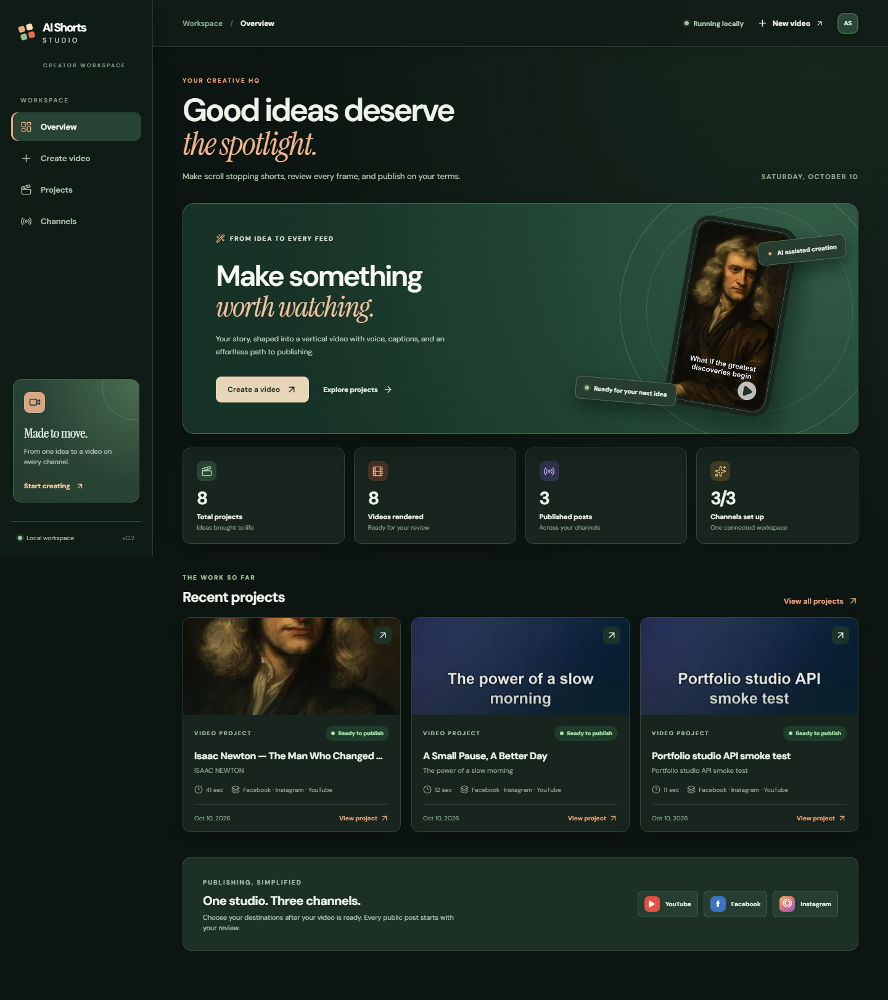

# AI Shorts Studio

A local portfolio studio that turns a topic or supplied narration into a vertical video, then publishes it to YouTube Shorts, a Facebook Page Reel, and an Instagram professional account Reel. It has a React frontend, FastAPI backend, and a reusable Python publishing engine. SQLite stores jobs and recovery state. It has no n8n dependency.



See the [architecture guide](docs/ARCHITECTURE.md) for the API routes and data flow.

For account setup, follow [Connect the accounts](docs/CREDENTIAL_SETUP.md). The local `.env` can be used for generation before any publishing account is connected.

## How it works

`shorts/cli.py` validates input and manages jobs. `script.py` calls a configured OpenAI-compatible chat endpoint and optionally retrieves short Wikipedia excerpts as factual notes. `voice.py` saves `edge-tts` audio and uses its **word boundary events** for captions. `footage.py` searches Pixabay and Pexels for verified visual subjects, accepts a local clip, or makes narration-based explainer cards when a matching clip is unavailable. `render.py` normalizes clips and burns captions with FFmpeg. `media.py` checks the MP4 with FFprobe. `publishers.py` contains independent official API adapters. `database.py` stores jobs, schedules, attempts, and remote IDs.

The portfolio UI lives in `frontend/`; `backend/` exposes local API routes and queues long-running jobs. The existing `shorts/` package remains the generation and publishing engine used by both the API and CLI. Each job has its own output folder; uploaded clips use content-addressed filenames so jobs can be reopened later.

```text
backend/              FastAPI routes, request models, background runtime
frontend/             React, Vite, responsive studio screens
shorts/               video pipeline, publishers, database, CLI
scripts/              local launch helper
tests/                engine and API tests
docs/                 account setup and project notes
work/                 generated videos and SQLite data (ignored by Git)
.secrets/              local OAuth and Meta tokens (ignored by Git)
```

## Run the portfolio studio

From PowerShell in `D:\Shorts`, install the web packages once. Keep your existing `.env` and `.secrets/` files.

```powershell
.\.venv\Scripts\python.exe -m pip install -e ".[web,vision]"
cd frontend
npm install
cd ..
.\scripts\start-web.ps1
```

Open **http://127.0.0.1:8000**. The launcher builds the frontend and starts the local API. Create a video, wait for the render, preview the MP4, tick the review checkbox, then publish to your selected channels. Facebook and Instagram Reels are public. YouTube defaults to private unless you choose another visibility in the creation form. A failed Edge TTS request for an English voice uses an installed Windows speech voice; the project detail shows which voice source was used.

For development, open two PowerShell terminals. The backend's npm command starts Uvicorn with reload using the project's `.venv`; it does not require Node packages in `backend/`.

```powershell
cd D:\Shorts\backend
npm run dev
```

```powershell
cd D:\Shorts\frontend
npm run dev
```

Open **http://127.0.0.1:5173** in development. Vite forwards `/api` requests to the Python backend. The built frontend is served by FastAPI on port 8000. Restart the backend after editing `.env`. Keep the API bound to localhost because it can use your publishing credentials. API docs are at **http://127.0.0.1:8000/docs**.

## Install on Windows PowerShell

Python 3.12 or newer and FFmpeg with FFprobe are required. This project was built and tested with Python 3.14.2 and FFmpeg 9.0.2.

```powershell
cd D:\Shorts
winget install --id Gyan.FFmpeg -e --scope user
py -3.14 -m venv .venv
.\.venv\Scripts\python.exe -m pip install -e ".[web,vision]"
if (-not (Test-Path .env)) { Copy-Item .env.example .env }
.\.venv\Scripts\python.exe -m shorts check
```

The web studio needs no LLM or stock video key when you paste a narration script; it creates narration-based explainer visuals if no relevant stock footage is available. Set `PIXABAY_API_KEY` or an existing `PEXELS_API_KEY` to search for clips. The optional **Background keywords** box accepts up to four comma-separated visual subjects, such as `chatbot screen, document search, data dashboard`. These take priority over AI-suggested searches. Stock clips must have matching Pixabay tags or descriptive Pexels page titles **and** pass a check of sampled portrait-cropped frames. The `[vision]` extra uses a local CLIP model; its first use downloads about 155 MB to `work/models`. If the extra is not installed, an image-capable `STOCK_VISION_MODEL` (defaults to `LLM_MODEL`) and `LLM_API_KEY` can provide the check. If verification fails or is unavailable, that scene uses an original visual based on its narration. A local video upload can be MP4, MOV, MKV, or WebM and takes priority over these keywords. Set **Start footage at** under creative controls to use a later section of the clip. The footage audio is replaced by the generated voiceover. Keep the studio on localhost because it can access configured publishing credentials.

The local vision weights come from [Xenova's ONNX conversion of OpenAI CLIP ViT-B/32](https://huggingface.co/Xenova/clip-vit-base-patch32). The model files stay in `work/models` and are not committed to this repository.

Open a new PowerShell window after installing FFmpeg if its aliases are not found. Alternatively, set `FFMPEG_PATH` and `FFPROBE_PATH` in `.env` to the two executable paths. The `check` command shows which prerequisites are available without printing secret values.

## Generate a video

Set `LLM_API_KEY` in `.env` to use a topic alone. The default endpoint is NVIDIA NIM. For OpenRouter, set `LLM_BASE_URL=https://openrouter.ai/api/v1`, its key, and an available `LLM_MODEL`. You can set `LLM_FALLBACK_MODEL=nvidia/nemotron-3-super-120b-a12b:free` so a specific free model is tried when the selected model is unavailable. The app expects a compatible `/chat/completions` response. A script file needs no LLM key.

The configured free Gemma 4 model uses JSON output mode, because [OpenRouter lists it as supporting JSON output without schema enforcement](https://openrouter.ai/google/gemma-4-26b-a4b-it:free). The generator validates the script fields and retries once if a response is malformed or cut off. If a provider remains unavailable, use the project's **Retry** button or supply a narration script.

```powershell
.\.venv\Scripts\python.exe -m shorts generate "Five surprising facts about space" --duration 45
.\.venv\Scripts\python.exe -m shorts generate "A quiet moment under the stars" --duration 12 --script-file tests\fixtures\smoke_script.txt
.\.venv\Scripts\python.exe -m shorts generate "How to prune roses" --duration 30 --source-file my-facts.txt --footage-file my-licensed-clip.mp4
.\.venv\Scripts\python.exe -m shorts generate "How search engines work" --duration 30 --background-keywords "search results screen, website index, server racks"
.\.venv\Scripts\python.exe -m shorts generate "A quiet scene" --duration 12 --script-file tests\fixtures\smoke_script.txt --footage-file my-licensed-clip.mp4 --footage-start 8
```

Use `--language`, `--tone`, `--voice`, `--title`, `--description`, and `--hashtags "#one,#two"` as needed. For non-English speech, choose an appropriate Edge voice; list available voices with `.\.venv\Scripts\python.exe -m edge_tts --list-voices`. `--source-file` supplies facts to ground the LLM. Without it, the app tries relevant Wikipedia summaries and asks the LLM to avoid unsupported specifics. **Review factual and rights-sensitive content before public publishing.**

Set `WIKIMEDIA_USER_AGENT` to identify your app and a contact address or project URL before relying on Wikipedia lookup.

The output lives at `work/<job-id>/final.mp4`; the folder also contains the script JSON, voice MP3, SRT and ASS captions, and metadata. `work/cache/pexels` and `work/cache/pixabay` keep downloaded clips; Pixabay search responses are cached for 24 hours. Each job gets its own folder. Stock clip source credits are added to the description. Review the [Pexels API guidelines](https://www.pexels.com/api/documentation/) or [Pixabay API terms](https://pixabay.com/api/docs/) for the source you use.

`VIDEO_WIDTH=720` and `VIDEO_HEIGHT=1280` are efficient defaults. Set 1080 and 1920 for full HD. A narration that differs too much from the requested length is rate-adjusted once or rejected with an instruction to change the script. Automatic searches must connect to the topic or narration, and clip metadata must match at least two specific terms from a multi-term search. Relevance outranks portrait orientation. Pixabay is tried first because its video tags make relevance easier to check; Pexels is used when its page title supplies a matching subject. Each candidate's frames are checked before use, with a limit of three candidates per scene. `STOCK_FALLBACK=concept` creates an explainer card for each scene without a verified clip. Set `STOCK_FALLBACK=error` to stop generation instead, or `gradient` for the older plain backdrop. Review the finished video before publishing because automated visual judgments can still be imperfect.

## Publish

Choose destinations when creating a job. `generate_only` is the default. To publish later, select the destinations at generation or add them on the `publish` command.

```powershell
.\.venv\Scripts\python.exe -m shorts generate "An original story" --duration 30 --platforms youtube,facebook,instagram --publish-mode generate_only
.\.venv\Scripts\python.exe -m shorts publish JOB_ID --platforms youtube,facebook
.\.venv\Scripts\python.exe -m shorts generate "An original story" --duration 30 --platforms youtube --publish-mode immediate --visibility youtube=private
.\.venv\Scripts\python.exe -m shorts list
.\.venv\Scripts\python.exe -m shorts status JOB_ID
.\.venv\Scripts\python.exe -m shorts retry JOB_ID
```

Repeated submissions with the same inputs return the same job; `--idempotency-key` can provide a stable caller key. Use `--new` to intentionally generate a fresh job. A successful destination is never uploaded again by `retry`. If an upload may have completed without returning an ID, the destination becomes `needs_review`. Check the account first, then use `--force-unknown` only when you have established that another upload is needed. A `processing` result means the platform has not yet confirmed completion; run `worker` again to poll it.

### YouTube

1. In Google Cloud, enable the YouTube Data API and create an OAuth **Desktop app** client. Save its downloaded JSON as `.secrets/client_secret.json`.
2. Run `.\.venv\Scripts\python.exe -m shorts auth-youtube` and grant both the YouTube upload and read scopes. The refreshable token is saved to `.secrets/youtube-token.json`. Reauthorize if you previously granted only upload access; the read scope is required to check processing and privacy status.
3. Use `--platforms youtube`. Visibility defaults to **private**; `--visibility youtube=unlisted` or `youtube=public` changes it. Use `--made-for-kids` when appropriate and `--contains-synthetic-media` when the content requires disclosure.

The adapter uses the [YouTube `videos.insert` resumable upload](https://developers.google.com/youtube/v3/docs/videos/insert) and checks processing status with [`videos.list`](https://developers.google.com/youtube/v3/docs/videos/list) before marking success. An upload ID does not establish that the video is public or will be distributed as a Short. [Shorts can be vertical or square and up to three minutes](https://support.google.com/youtube/answer/15424877). The current [quota guide](https://developers.google.com/youtube/v3/getting-started) says `videos.insert` is subject to a separate default daily upload allocation; check your console's current quota.

### Facebook Page Reels

Create a Meta app, select a Page you manage, obtain a Page access token, and set `META_PAGE_ID` and `META_PAGE_ACCESS_TOKEN`. Confirm the app's current Page publishing permissions and any required App Review in the Meta dashboard. The adapter follows Meta's [Page Reel start, local upload, status, and finish flow](https://www.postman.com/meta/facebook/documentation/r56bjfd/facebook-api?entity=request-23987686-0b79260c-96bd-49de-875b-6076213785fc). It does not publish to personal profiles. This implementation accepts 4–60 second, 9:16 Reels at 540×960 or higher, matching that documented flow. Facebook visibility is public.

### Instagram Reels

Use a supported professional account connected to the configured Facebook Page. Find its Instagram user ID and set `INSTAGRAM_USER_ID`; ensure the Page token grants Instagram content publishing access. Meta's [official Reels collection](https://www.postman.com/meta/instagram/documentation/23987686-9386f468-7714-490f-9bfc-9442db5c8f00) describes the media container, status, and `media_publish` operations. The adapter uses that **Facebook Login** variant and does not implement the separate Instagram Login token flow.

Instagram uploads the local MP4 directly to Meta with the [resumable file upload flow in Meta's sample app](https://github.com/fbsamples/reels_publishing_apis/blob/main/insta_reels_publishing_api_sample/README.md#resumable-upload-file-upload-upload_typeresumable). No S3 bucket or public video URL is needed. The adapter creates a Reel container, uploads the file to Meta's returned upload URI, checks processing status, and calls `media_publish`. Instagram visibility is public.

## Schedule and recover

Generate now and publish later with a timezone-aware ISO 8601 time. Missed times publish on the next worker run. A video that has not generated successfully is never published. `worker` also resumes interrupted generation after its two-hour job lease expires and polls platform `processing` states. It does not automatically retry a permanent failure or an uncertain upload.

```powershell
$when = (Get-Date).AddHours(2).ToString("yyyy-MM-ddTHH:mm:sszzz")
.\.venv\Scripts\python.exe -m shorts generate "A small idea" --duration 30 --platforms youtube --publish-mode schedule --scheduled-at $when
.\.venv\Scripts\python.exe -m shorts worker
.\.venv\Scripts\python.exe -m shorts cancel JOB_ID
```

For automatic polling on Windows, register a Task Scheduler job that runs one worker pass each minute:

```powershell
$action = New-ScheduledTaskAction -Execute "D:\Shorts\.venv\Scripts\python.exe" -Argument "-m shorts worker" -WorkingDirectory "D:\Shorts"
$trigger = New-ScheduledTaskTrigger -Once -At (Get-Date).AddMinutes(1) -RepetitionInterval (New-TimeSpan -Minutes 1)
Register-ScheduledTask -TaskName "Shorts Worker" -Action $action -Trigger $trigger -Description "Publish due Shorts jobs"
```

The one-shot worker exits instead of waiting for future jobs. You can also run `worker --loop` in a supervised terminal. `cancel` is available before publishing begins.

## Test and troubleshoot

```powershell
.\.venv\Scripts\python.exe -m unittest discover -s tests -v
.\.venv\Scripts\python.exe -m shorts check
```

Tests mock external APIs and do **not** publish publicly. One test creates a real small FFmpeg video and validates it with FFprobe. Check `work/shorts.log` and `status JOB_ID` after a failure. Missing keys are reported as setup errors. If Edge TTS cannot connect, check network access and voice availability. If FFmpeg is missing, set its paths in `.env`. If Meta returns permission or token errors, renew the Page token and confirm account, Page, app mode, permissions, and Graph version.

`tests/test_live.py` is opt-in. Set `SHORTS_LIVE_TESTS=1` for live LLM and Pexels checks. Set `SHORTS_LIVE_VIDEO` to a validated MP4 and one of `SHORTS_LIVE_YOUTUBE_UPLOAD=1`, `SHORTS_LIVE_FACEBOOK_UPLOAD=1`, or `SHORTS_LIVE_INSTAGRAM_UPLOAD=1` to test an actual upload with the configured credentials. YouTube's check uploads **private**; Facebook and Instagram checks create **public** Reels. Each run creates a new remote post. Earlier manual upload checks in this workspace succeeded on all three platforms; the automated suite keeps these external tests off by default.

Set `WEBHOOK_URL` to an HTTPS endpoint for optional completion, partial completion, or failure notifications. The payload contains job and per-platform status, without credentials. Notification delivery is best effort and never changes the job result.

Current limitations: Publishing depends on valid account tokens and platform permissions; routine tests mock remote calls. OpenRouter script generation, local video builds, and one upload per platform have been exercised. Pexels remains optional and untested without a key. Wikipedia snippets help ground scripts but do not replace editorial fact checking. The CLI generates synchronously; the web API runs jobs in the background. Task Scheduler supplies recurring execution. The web studio is local and has no user authentication. Music mixing, thumbnail upload, original-audio clip editing, and automated Meta OAuth consent are not implemented in this main pipeline.
