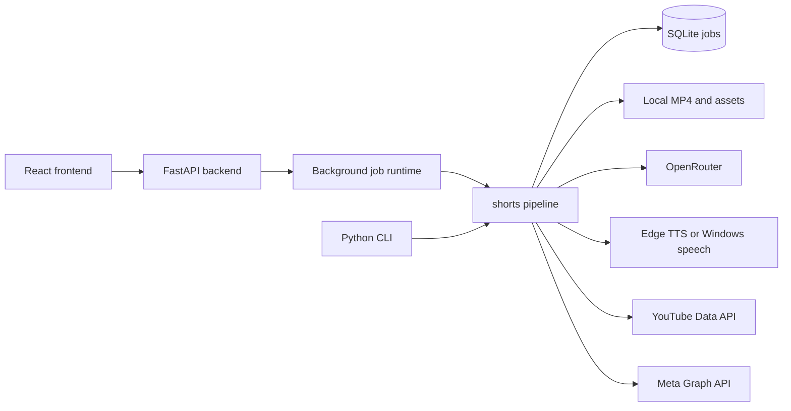

# Architecture

AI Shorts Studio has a local React interface, a FastAPI process, and one Python package for video creation and publishing. The web app and CLI share the same SQLite database and job pipeline.

## Folders

| Folder | Responsibility |
| --- | --- |
| `frontend/src/pages/` | Dashboard, create form, project library, review and publishing, channel status |
| `frontend/src/components/` | Shared navigation, cards, status, and empty states |
| `backend/api/` | JSON routes, safe job responses, MP4 preview, footage upload |
| `backend/runtime.py` | Runs long jobs outside HTTP requests and polls due jobs |
| `shorts/` | Script, audio, footage, render, validation, database, and official publishers |
| `work/` | Generated files and SQLite state; ignored by Git |
| `.secrets/` | OAuth credentials and tokens; ignored by Git |

## Web API

| Route | Purpose |
| --- | --- |
| `GET /api/overview` | Counts, recent projects, and configured destinations |
| `GET /api/health` | Nonsecret local setup status |
| `GET /api/jobs` | Recent project list |
| `POST /api/jobs` | Validate inputs and queue a draft render |
| `GET /api/jobs/{id}` | Poll a job and its per-platform results |
| `GET /api/jobs/{id}/video` | Stream the validated MP4 for preview or download |
| `GET /api/jobs/{id}/thumbnail` | Get a cached preview image |
| `POST /api/uploads/footage` | Validate and store a licensed local clip |
| `POST /api/jobs/{id}/publish` | Publish selected destinations after review |
| `POST /api/jobs/{id}/retry` | Retry failed generation |

The frontend generates a draft first. The user previews the video and metadata, checks the review box, then chooses destinations. The API rejects publication when the review flag is absent. Each publisher records remote IDs and status in SQLite; successful destinations are not uploaded again on retry. The runtime polls queued and processing jobs while the backend is running.

The server binds to `127.0.0.1` by default. Do not expose it to an untrusted network without adding authentication and deployment safeguards. `.env`, `.secrets/`, `work/`, and frontend build outputs are ignored by Git.
